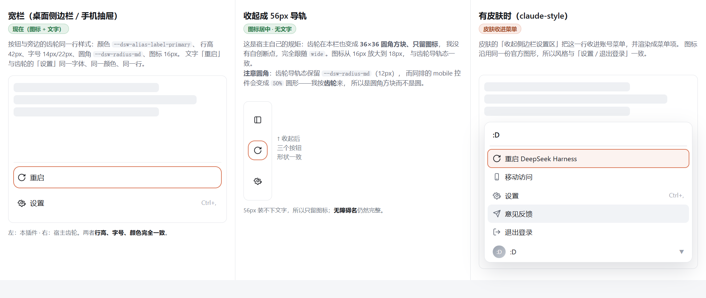
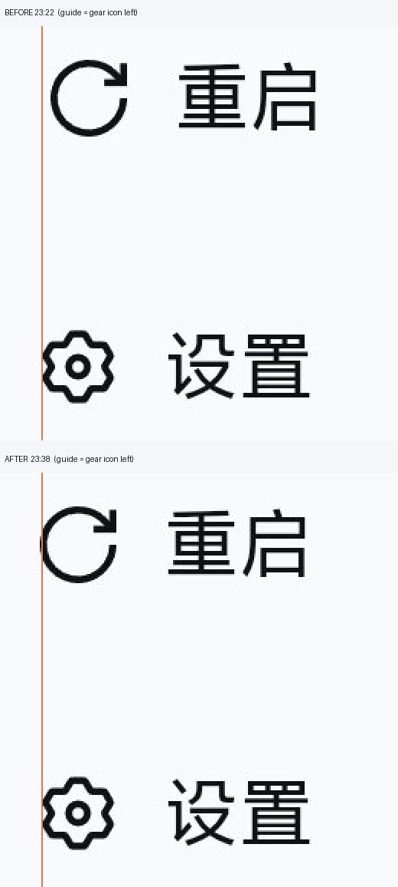
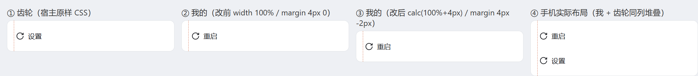

# dsh-desktop-restart

One row in the sidebar foot, beside the settings gear: restarts the DSH desktop
app in a single click, instead of quitting from the tray and relaunching by hand.

[](docs/placement-options.png)

## The control is a copy of the gear row next door

The seat is `sidebar.footer.action` — "optional actions beside Settings at the
sidebar foot". The shipped sidebar renders it as `footerActions`, a flex row that
`footArea` lays out **above** `settingsArea` (the gear row). So in the plain host
footer this control sits directly above the gear.

It is deliberately styled as the gear's twin, with every value read from the
shipped `.wCInkW_trigger` (ui-settings-general) and the seat's own sibling
`.dsh-mobile-control__trigger`, which agree:

| Property | Value | Why |
|---|---|---|
| colour | `--dsw-alias-label-primary` | the gear uses the **primary** label colour; a secondary-coloured icon beside it is a visible mismatch |
| height | `42px` | the footer row height both host controls use |
| padding | `0 10px 0 8px`, `gap 8px` | the gear's own padding and icon/label gap |
| radius | `--dsw-radius-md` | the gear's radius, not the small one |
| label | `14px / 22px`, `font: inherit` | the gear label's typography |
| row box | `calc(100% + 4px)`, `margin 4px -2px` | the gear's row is `.wCInkW_triggerRow{width:calc(100% + 4px);margin:4px -2px}` — it bleeds 2px past the column on each side, so its content begins at `parentLeft − 2 + 8 = +6`. Without the same bleed this row's icon **and** label sit 2px to the right of the gear's, and the two never line up. This button *is* its own row, so it carries both the bleed and the padding. |

Verified on a **real phone screenshot** (1216×2640, so ≈3.5 device px per CSS px),
measuring the dark ink of each row directly:

| row, on the device | icon ink left | label ink left | icon ink | row centre |
|---|---|---|---|---|
| before the bleed: 重启 | `73` | `157` | 50 | `2356.5` |
| before the bleed: 设置 | `67` | `150` | 48 | `2531.5` |
| after the bleed: 重启 | `66` | `150` | 50 | — |
| after the bleed: 设置 | `67` | `150` | 48 | — |

So the old geometry sat **+6 device px (≈2 CSS px)** right of the gear — the 2px the
CSS predicted — and the shipped geometry lands within **1 device px** on the icon and
**exactly 0** on the label. The two row centres are 175 device px apart, which is
`175 / 3.5 = 50.0` CSS px — precisely the designed `21 + 4 + 4 + 21`.

[](docs/row-alignment-device.png)

The orange line is the gear's own icon left edge. Before, the ↻ icon and the 重启
label both sit to its right; after, they land on it.

The equivalent check against the host's shipped CSS in a controlled 340px column
gives the same result to the hundredth:

| row | icon left | label left |
|---|---|---|
| the gear | `5.67` | `29.67` |
| this button, before the bleed | `7.67` (**+2.00**) | `31.67` (**+2.00**) |
| this button, after the bleed | `5.67` (**0.00**) | `29.67` (**0.00**) |

[](docs/row-alignment.png)

One residual is **not** a CSS mismatch and is deliberately left alone: on the device
the ↻ ink is 50px against the gear's 48px. Both icons are the host's own primitives at
the host's own `wide ? 16 : 18`, drawn on the same 16px box with the same 1.3 stroke —
a near-full circle simply carries more ink than a compact gear. Making the two inks
match would mean drawing the shipped artwork below the size the host asks for, which
is the one thing this row must not do.

**The label follows the host's own `wide` convention** — no invented breakpoint.
The gear's `TriggerContent` renders `wide ? <icon size 16> + label : <icon size 18>`,
and `dsh-mobile`, the seat's other occupant, does `wide ? <label> : undefined`.

The two icons can never disagree, because both seats are handed the **same**
`wide`. In the shipped sidebar there is one source:

```js
const wide = windowsTitlebar ? !collapsed : !collapsed || !settled;
renderSlot("sidebar.footer.action", { wide })   // this plugin
renderSlot("sidebar.settings",      { wide })   // the gear
```

and the gear forwards it unchanged to `settings.trigger`. So this plugin's
`wide ? 16 : 18` is the gear's `wide ? 16 : 18`, by construction.

The **registered component must forward the seat's props**. One that takes no
parameters drops `wide`, and the control then stays in its icon-only shape in every
state while still rendering "fine" — a defect invisible in review and obvious on a
phone. That is exactly what the first mobile screenshot showed: a bare icon in the
open wide drawer, above a labelled 设置. `test/client.test.mjs` now pins the
forwarding, and the check was confirmed by reintroducing the bug and watching it
fail rather than trusting a green run.

- **Wide column** (desktop sidebar; also the mobile drawer while it is *open*):
  icon **+ the word 重启 / Restart**, in the gear's font and colour.
- **Collapsed 56px rail**: 36×36, icon grown to 18px, no label — the gear's rail
  state. Note this is the one place the two host references differ, and the gear
  wins: `.wCInkW_trigger.wCInkW_rail` keeps `--dsw-radius-md` (12px), while
  `dsh-mobile`'s `.is-rail` swaps to `border-radius: 50%`. A circle beside a
  rounded square reads as a different control family, so this plugin uses the
  gear's rounded square.

On mobile specifically (`dsh-mobile`, overlay breakpoint `(max-width:720px)`, the
drawer is `min(88vw, 340px)`): the mobile bundle's `!important` rules target the
composer, the settings options page and sidebar row menus — **none** of them
touch `sidebar.footer.action` or the gear, and mobile defines no icon-size
variable. It only *reads* the host sidebar's own `_collapsed` class to decide
whether the drawer is open. So the two icons stay in step by construction, not by
a mobile-specific override.

Two skins/layouts are served by the same code, with no branching: with a skin that
folds the footer into the account popover (for example `dsh-claude-style`'s
`collapseFooter`, on by default), the skin hoists this same entry into its menu and
renders it as a menu row — where the identical icon still reads as part of the set.

The glyph is the shipped `IconRefreshOutlineArtwork` from
`@deepseek-ai/dsh-client-ui-primitives`, copied rather than imported (a plain-JS
bundle may not load a Harness Client package, and importing one is what the plugin
rules forbid). Same 16×16 box, same 1.3 medium stroke, same `currentColor` and
default caps, so it reads as part of the host's own icon set.

## Why the restart works this way

The obvious implementation is not available, and each dead end was verified
against the installed build rather than assumed:

- **The button cannot go inside the account menu.** Its items (`settings`,
  `contact`, `signout`) are a hard-coded array in
  `@deepseek-ai/dsh-client-ui-settings-account`; the menu exposes no plugin seat.
- **There is no restart API for plugins.** `window.dshDesktop` exposes only
  `browser`, `deviceInfo`, `keyboard`, `shortcuts` and `updates`; none of the 25
  `dsh-desktop:*` IPC channels restarts anything. The Host is a plain Node child
  of the Electron main process (`ELECTRON_RUN_AS_NODE=1`), so it cannot call
  `app.relaunch()`. The built-in "Restart App and Host" menu item exists but is
  gated on `!app.isPackaged`, so a released build never shows it.
- **Closing the window does not quit.** `window.on('close')` hides to the tray.
  Launching the app again is also a no-op: the single-instance lock turns the
  second launch into "focus the existing window".

So the restart is an out-of-process handoff: the Host answers `202`, then a
detached helper kills the Electron main process and the Host **by PID**, waits
until both are really gone (which is what keeps the relaunch from being demoted
by the single-instance lock), and starts the application again with the Node-mode
marker removed.

## What the tab does while that happens

The page cannot be told "restart finished" by a connection that is being torn
down, so after the `202` it polls the status route and compares the **boot id**.
A different boot id means the *new* process is answering, and the tab then calls
`location.reload()`. That reload is the point of the whole feature: it is what puts
the browser on the newly installed bundle instead of leaving it on the old code —
and it is why the progress dialog is dismissable (Escape, the scrim, or its
button) rather than a modal trap if the handoff never lands. The poll is read-only
and stops after `POLL_LIMIT` attempts, handing the UI back.

## Endpoints

Both are same-origin, loopback-only.

| Route | Method | Purpose |
|---|---|---|
| `/dsh-desktop-restart/status` | GET | boot id, PIDs, and whether a restart is possible here (with the reason when it is not) |
| `/dsh-desktop-restart/restart` | POST | performs the restart; answers `202` before the app is killed |

`POST` refuses any request that carries a forwarding header, does not come from
loopback, has an `Origin` that disagrees with `Host`, or is not
`application/json` (a cross-site page cannot send that content type without a
preflight this server does not answer). A single-flight latch makes a second
click during a restart a no-op instead of a second application.

## Settings

| Key | Default | Meaning |
|---|---|---|
| `handoffDelayMs` | `400` | How long the helper waits before killing, so the `202` reaches the browser. |

## Logs

Each restart writes `dsh-desktop-restart-<timestamp>.log` to the system temp
directory; the path is shown in the progress dialog and returned by the `202`.

## Limits

- It is a **hard** restart. It does not run the shell's quit inspection, and
  running tasks are interrupted — which is why the button confirms first.
- Freshly installed bundles may still need one manual restart to load. After
  that, this button is the way to restart.
- If a future DSH release changes the process model, the plugin degrades to a
  disabled button with a stated reason rather than damaging the app.

## Development

```sh
node --check index.js && node --check client.js
npm test
```

`test/client.test.mjs` pins the parts of the client half that are invisible until
they are wrong: that it loads React and no Harness package, that the glyph is the
official artwork rather than a redraw, that the control matches the gear row's
colour/metrics/typography, that the label follows the host's `wide` convention,
that every visible colour is a theme token, and that its only mutation is the JSON
restart POST.

